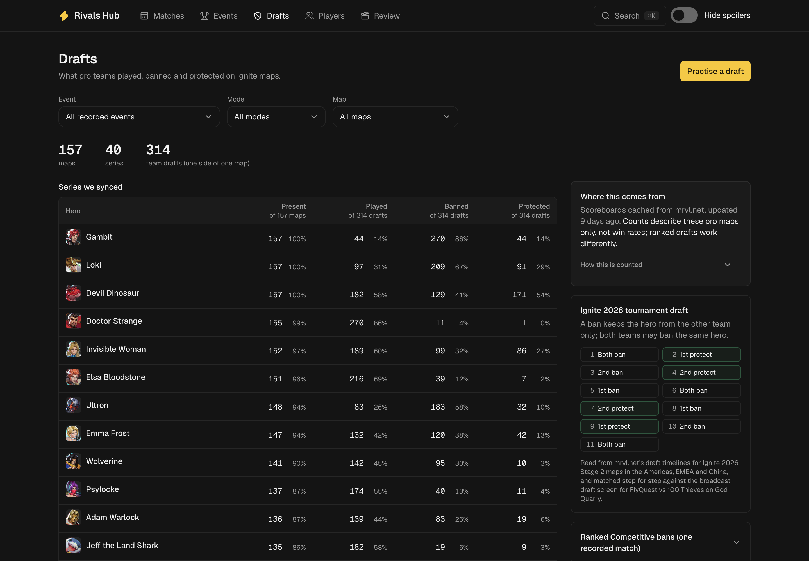

# Rivals Hub

A Marvel Rivals companion for following Ignite, exploring pro drafts, and looking up player performance. Scores, brackets, match stats and ranked profiles in one place, without an account.

**[Open Rivals Hub →](https://rivalshub.kellycooks.dev)**



The live draft explorer, captured 18 November 2026. Pro statistics from mrvl.net; game artwork belongs to its respective owners.

## Features

- **Follow Ignite 2026** — live scores, upcoming series, results and regional event brackets.
- **Go inside a match** — map results, player stats, MVP/SVP and draft picks where the sources provide them.
- **Explore drafts** — hero picks, bans and protects, map filters and a step-by-step Ignite draft simulator.
- **Look up players** — ranked profiles, hero performance, match history, favourites and the PC leaderboard. Private histories stay private.
- **Review matches** — keep a local review workspace with bookmarks and notes.
- **Stay spoiler-free** — hide results while browsing, with times shown in your own timezone.
- **Jump anywhere** — search teams, matches, events, players and pages with ⌘K / Ctrl+K.

Coverage and freshness depend on the upstream sources; missing stats aren't estimated.

## Tech stack

[React](https://react.dev), [TypeScript](https://www.typescriptlang.org), [Void](https://void.cloud) and [Vite](https://vite.dev), with [Tailwind CSS](https://tailwindcss.com), [beUI](https://beui.dev) and [Motion](https://motion.dev). Hosted on Cloudflare Workers with KV for esports snapshots and D1 for player caching and favourites. [Zod](https://zod.dev) validates incoming data.

## Run locally

Install [Bun](https://bun.sh) 1.4.2 and Node.js 24.22.2 (the version in `.node-version`), then:

```sh
git clone https://github.com/KelechiOdom10/mr-ignite-live.git
cd mr-ignite-live
bun install --frozen-lockfile
bunx void db migrate
PLAYER_DATA_MODE=fixtures bun run dev
```

Open **http://localhost:5180**. No provider key or Cloudflare token is needed for local development. Player pages replay recorded fixtures by default; try [Sypeh](http://localhost:5180/player/670067075). This is **not a fully offline demo**: esports pages sync Liquipedia and mrvl, and images may use the network. A cold snapshot can take minutes to build. Don't enable live player requests just to test a change.

## Development

```sh
bun run check       # formatting, lint, boundaries, generated types and tests
bun run test        # Vitest suite
bun run fmt         # format
bun run build       # production build
```

Read [AGENTS.md](AGENTS.md) before contributing. Run `bun run check` before a commit, preserve recorded fixtures, and never commit tokens or `.env` files. The [verification guide](.claude/skills/verify/SKILL.md) covers isolated browser testing; [architecture and operations](docs/architecture.md) explains the sync, directory layout, environment settings and remaining scripts.

## Deploy

**A push or merge to `main` automatically deploys production after checks pass.** Don't merge a change as a way to preview it. Deployment requires your own Cloudflare credentials; a fork must use its own resources and domain, not the saved production configuration. See [deployment setup and token permissions](docs/architecture.md#deploy).

## Data and acknowledgements

- [Liquipedia](https://liquipedia.net/marvelrivals/) supplies tournament schedules, brackets and results.
- [mrvl.net](https://www.mrvl.net) supplies pro player/map stats and draft data.
- [RivalsTracker](https://rivalstracker.com) supplies player profiles, ranked matches and the leaderboard.
- [beUI](https://beui.dev) supplies the copied UI components.

See [data sources and reuse](docs/data-sources.md) and [third-party notices](THIRD_PARTY_NOTICES.md). Provider data, game artwork and logos aren't ours to relicense. This is an independent fan project, not affiliated with or endorsed by Marvel, NetEase Games, the tournament organisers or the data providers. Their names and trademarks belong to their respective owners.

## Author and license

Built by [Kelechi Odom](https://github.com/KelechiOdom10).

An open-source license for the original application code has not yet been selected. Public visibility alone does not grant an open-source license; the third-party licenses and data restrictions still apply.
